# 游戏状态机与单元测试设计

## 0. 使用方式与边界

本文按用户要求固定开发顺序：**状态机与规则 → 实现相关单元测试 → 离线组合回归 → 稳定候选集中真机验收**。不再用反复启动游戏或空过回合探索代替开发测试。

这是设计与测试索引，**不是通过报告**。箭头表示应满足的转换；不表示相应代码已经实现或已通过测试。规则以[实施计划](OVERNIGHT_PLAN.md)、[测试规格](TEST_SPEC.md)、[定稿契约](../reference/bear-forge/docs/volibear/DEVELOPMENT.md)为准。

采用多组关联状态机，而不是把所有情况塞进一个巨图：

- 战斗状态、牌区、牌形态、出牌实例、敌人机会、效果提交状态分别保存，不能用一个 `completed` 布尔值代替。
- 同一个对象不等于同一次调用；同一个已完成 Task 也不等于同一次调用。
- **已经提交的事实不会因为后续异常而自动回滚；被中断的动作也不能无条件重试。**
- 未知来源、未实现转换和缺失观测分别标明，不能猜测后计为通过。
- 下列图覆盖机制族与关键生命周期。具体敌人的全部 move/guard/分支仍须按[敌人覆盖口径](TEST_SPEC.md)逐项展开；本图不宣称穷举任意组合。

每条正式测试记录：`transition_id / rule_id / precondition / input / expected_events / expected_state / identity / forbidden_effects / production_entry`。期望来自规则，不从被测实现反向生成。

## 1. 整局与战斗生命周期（RUN）

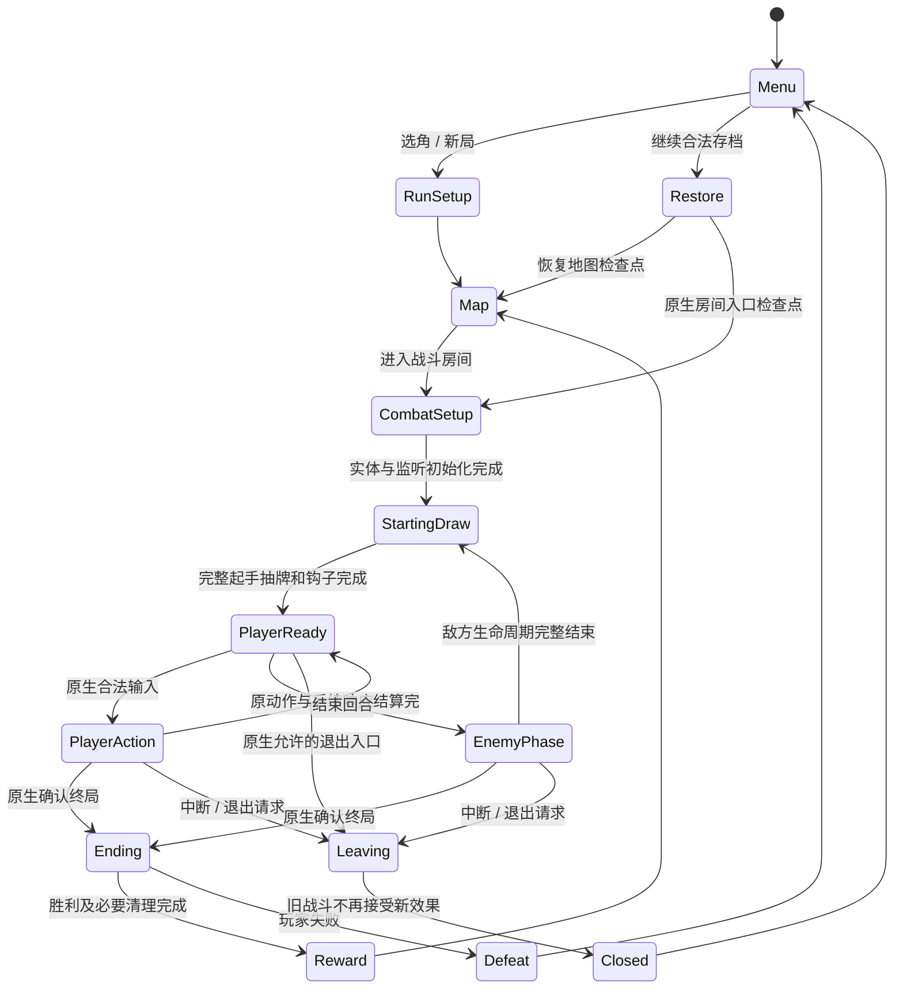

| 转换 | 前提与必须保持的事实 | 规则 |
|---|---|---|
| RUN-01 初始化→可输入 | 实体属于本次战斗，队列与正常起手已结束；旧战斗监听不能接管新对象 | D18 / S01 |
| RUN-02 玩家→敌方→下一玩家 | 不漏原生生命周期；已迎战消费的敌人只跳其已消费动作，不跳整段敌方阶段 | E14 / D05 |
| RUN-03 执行中→退出 | 先撤销旧执行权限；等待中的旧任务不能写入新战斗；已发生事实不得假装没发生 | E16 / D17 / V08 |
| RUN-04 终局→奖励/失败 | HP=0、死亡确认、移除和胜利分别核对；不由单个 HP 值直接宣告胜利 | E12 / D14 |

`Leaving` 的安全清理不等于随意取消原生 Task。未能处理的原生跨 await 路径仍是实现缺口，不能靠捕获所有异常吞掉。

## 2. 一次真实出牌、支付与重演（CARD）

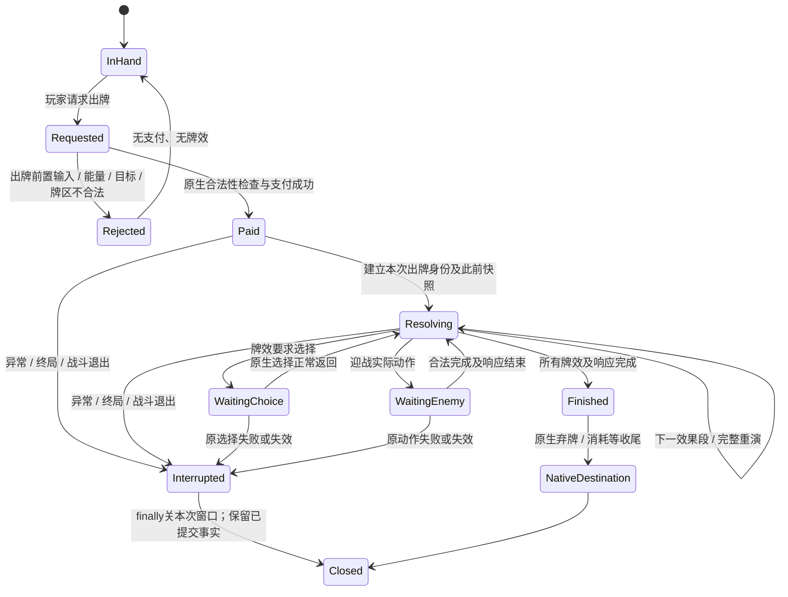

- **CARD-01** 支付前的非法出牌尝试不支付、不计真实出牌、不触发牌效（P14）。支付后的牌效选牌失败属于 `WaitingChoice → Interrupted`，不能承诺退款或自动回到手牌。
- **CARD-02** 支付成功后才建立对应的实际结算；X 保存的是本次实付值（P01）。
- **CARD-03** 重演仍属于同一次真实出牌：不再支付、不再计一张牌，共享目标、已支付 X、此前条件快照，但完整重复应重复的牌效（P03/P06）。
- **CARD-04** 领域附雷资格在发起雷伤之前预占；重入或重演不能重复领取；当时没有领域，不提前消耗未来合法资格（D01–D04）。
- **CARD-05** 关闭后不能因迟到响应重新领取资格；异常不是退款或自动重试部分牌效的许可（E16）。

纯生产内核入口：[出牌附雷门与抽牌时钟](../src/Volibear/Core/CardResolutionState.cs)。原生支付、实际牌区移动、整段牌效与 UI 不是该内核能单独证明的内容。

## 3. 敌人动作机会与迎战（ENEMY）

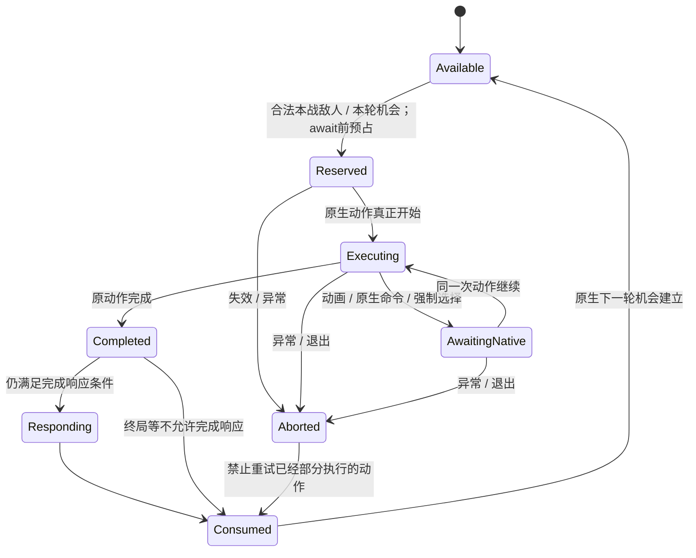

| 转换 | 断言 |
|---|---|
| ENEMY-01 同轮重入 | `Reserved/Executing/Consumed` 均不能再次启动同敌动作；不能等到 await 返回才占位（E05）。 |
| ENEMY-02 多段攻击 | 每段按真实格挡吸收计数；坚甲下也计吸收，不能拿格挡净差或生命损失代替（E01–E04）。 |
| ENEMY-03 混合/非攻击动作 | 执行真实副作用；领域只改允许压制的贡献，不按意图数字模拟（E08/E09）。 |
| ENEMY-04 后续正常敌方阶段 | 机会只消费一次，下一 move 推进恰好一次，其它敌人与生命周期照常（E14/E20）。 |
| ENEMY-05 中途死亡 | 后续段/完成响应由原生死亡与战斗有效性决定，不给尸体追加动作（E11/E12）。 |
| ENEMY-06 多敌迎战 | 固定合法顺序串行，吸收窗口彼此独立；新召唤物机会遵循原生规则（E10/E13/E15）。 |

入口：[真实迎战](../src/Volibear/Core/EngageCmd.cs)。具体敌人的选择、状态推进、召唤与被动再与下述状态机组合，不把此通用图当作全部 AI 状态表。

### 3.1 新召唤敌人的机会（E13，锁定版本源码推导，非执行结果）

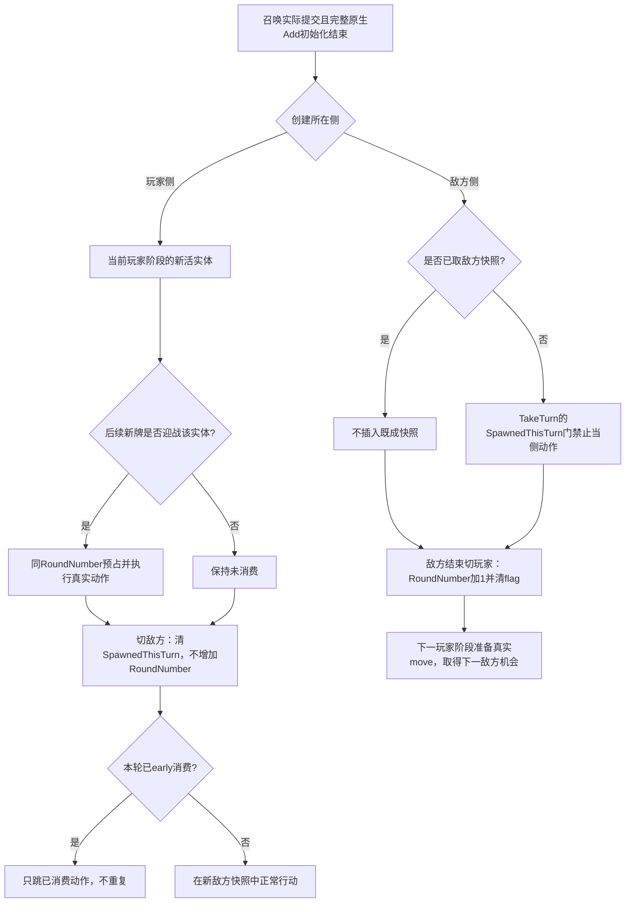

- `SpawnedThisTurn` 不是跨玩家→敌方阶段的整轮禁行动令。玩家侧完成召唤后，切敌方先清该flag且round不变，因此后续新牌可提前消费新实体的本轮机会；不能给迎战入口硬加统一 `!SpawnedThisTurn` 拒绝。
- 同一张R09的目标集合在开始时固定，不纳入中间召唤；后续新牌重新取得集合，可以包含已完成初始化的新敌。两件事不能混同。
- 额外玩家回合的切侧也可能清flag，但不增加正常RoundNumber；清flag不返还已经消费的机会。
- 源码依据是锁定版本的 `CreatureCmd.Add → AfterCreatureAdded/PrepareForNextTurn`、`SwitchSides → OnSideSwitch`、`ExecuteEnemyTurn`固定快照与`TakeTurn`门；不推论Add尚未初始化完成的重入也可安全迎战。
- 集中原生验收仍须覆盖：玩家侧新敌未迎战/已迎战各一次及下一轮；同牌R09排除而新牌纳入；敌方快照前/后召唤均不插队；额外回合不重置机会与领域取消创建。

## 4. 领域持续时间与起手抽牌（DOMAIN）

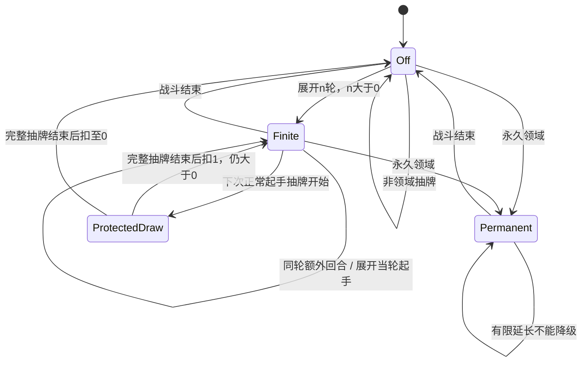

- **DOMAIN-01** 开启当轮不提前扣；敌方阶段和下一正常起手整段抽牌仍受保护（D05）。
- **DOMAIN-02** 同轮额外回合不重复消费正常轮数；重复边界通知不再次扣（D05）。
- **DOMAIN-03** 起手抽牌内展开，不在同一次抽牌末立即扣掉它（D05）。
- **DOMAIN-04** 永久状态与有限上限分开；不能让有限叠加溢出或碰撞永久哨兵（D06）。
- **DOMAIN-05** 正常起手结束的扣轮发生在后续起手兽化响应之前（F07）。

入口：[DomainPower](../src/Volibear/Core/DomainPower.cs)、[DrawClock/Duration](../src/Volibear/Core/CardResolutionState.cs)。图中 `ProtectedDraw` 是契约阶段，不表示现有内核含同名枚举。

### 4.1 抽牌净化与移动

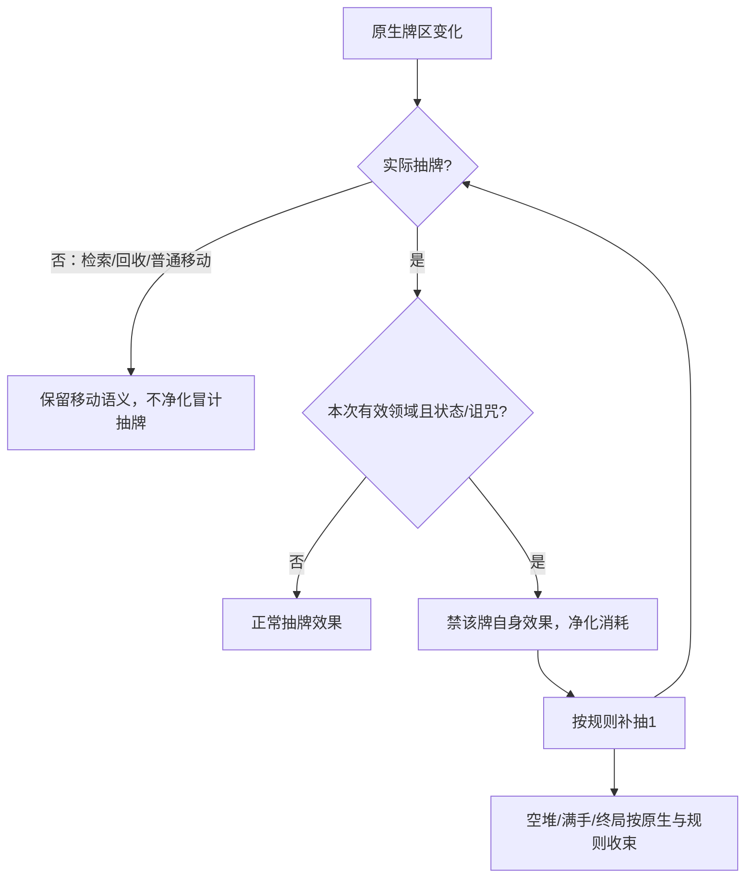

**DRAW-01** 连续脏牌、洗牌、空堆、满手必须有终止条件；补抽不是复制原牌。**DRAW-02** 与兽化响应联动时仍区分“本批固定集合”和新抽入手牌（D07/D08/F05/P07）。

## 5. 领域对敌方贡献的判定（EFFECT）

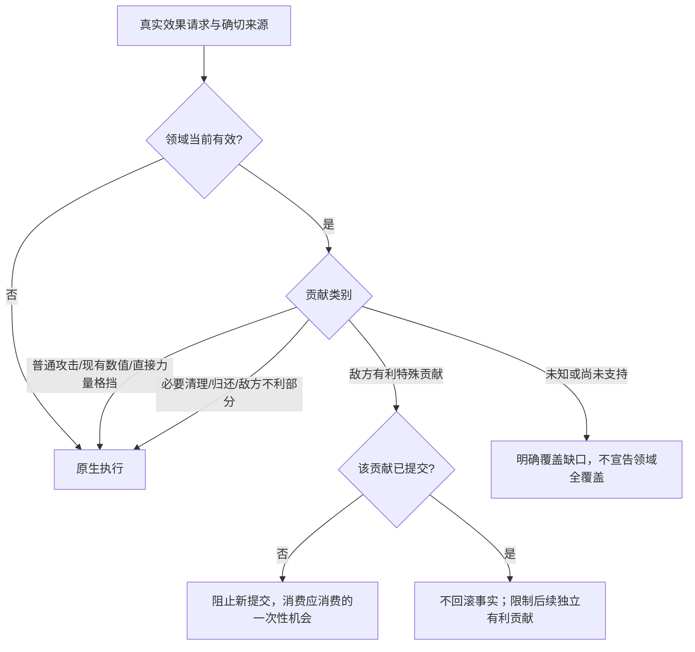

**EFFECT-01** 不能整招跳过或删除整份混合 Power。**EFFECT-02** 来源在等待期间仍须按实际执行点复核；领域退出不补发已取消/已消费的一次性效果。**EFFECT-03** 未知来源不能借另一动作身份；观测不足与游戏应该怎么结算是两件事（D09–D20）。

“已提交”须以实际 mutation 为界，不以“开始调用”“返回非 null”“日志里写了成功”为界。

## 6. 雷伤批次与响应（LIGHTNING）

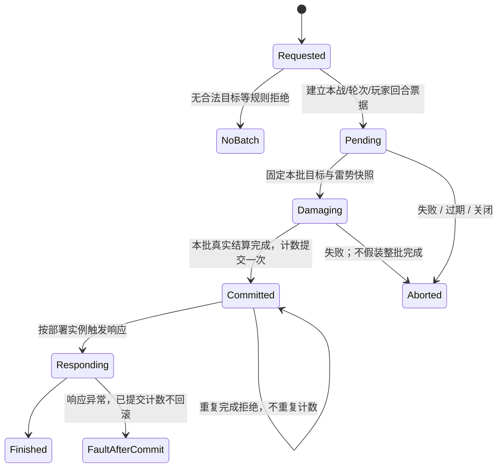

- **LIGHTNING-01** 全体一批只计一次；全部被格挡仍是有效一批；其它 Unpowered 伤害不冒充雷伤（L01–L04）。
- **LIGHTNING-02** 当前批共用增幅快照；响应增加的雷势只影响后续批次（L05/L06）。
- **LIGHTNING-03** 额外玩家回合重置回合计数，但不清本战雷势；与领域正常抽牌时钟不是同一个时钟（L05/F08）。
- **LIGHTNING-04** 旧回合/已关闭战斗的票据迟到不能完成；重复 Complete/Abort 不能影响另一票据。
- **LIGHTNING-05** 完成计数先于订阅者调用；订阅者抛错不能把计数回退后重放批次。

入口：[LightningCounter](../src/Volibear/Core/LightningCounter.cs)、[LightningBatches](../src/Volibear/Core/LightningBatches.cs)。前者只证明记账，不模拟格挡、伤害或 HP。

## 7. 兽化、牌区、费用（FORM）

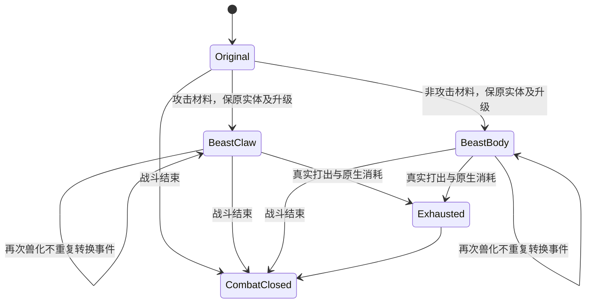

这不是用新卡替换旧卡的许可：牌形态、实际牌区、永久主牌关联分别记录。永久牌组不因战斗覆盖层而变成兽形。

| 转换 | 不变量与边界 |
|---|---|
| FORM-01 转换 | 相同实体/owner/master引用；升级、已有减费和保留按规则保留；原牌特殊效果不再执行（F01/F02）。 |
| FORM-02 转换响应 | 先提交形态覆盖再通知监听；监听异常不能谎称没转换或重新发转换事件。 |
| FORM-03 批量转换 | 固定原批集合；响应中新抽牌不能加入同批；同实体不重复选择（F03/F05/F06）。 |
| FORM-04 打出 | 预览与实际支付一致，兽形最终消耗；0费文案不新增永久费用改写（F04/P02）。 |
| FORM-05 多实例 | 每个部署的首次/每次资格独立；轮次重置不能替另一实例消费（F07/F08）。 |

费用另有状态：`无券 → 已准备 → 合法真实出牌消费 / 到期`；重演不二次消费。普通同类优惠取最大、R14按目标累加，不能混为同一种账本（P02）。

入口：[BeastForms](../src/Volibear/Core/BeastForms.cs)、[BeastCostLedger](../src/Volibear/Core/BeastFormsCost.cs)、[TargetCosts](../src/Volibear/Core/TargetCosts.cs)。

### 7.1 独立部署、待用效果与到期（DEPLOY）

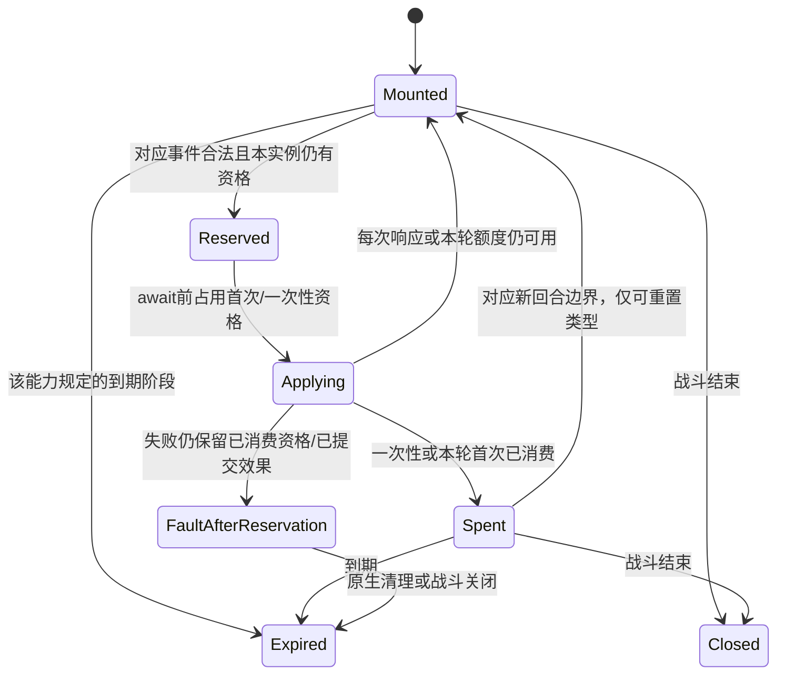

- **DEPLOY-01** 一份逻辑部署的资格不由另一份消费；原生可能在同一Power模型内储存多份逻辑实例，不强行要求每份都有独立PowerModel。
- **DEPLOY-02** 首次/每次/偶数次、真实出牌/每牌效段、正常回合/额外回合是不同事件定义；U21部署时不能补发历史所有偶数次奖励（L08/P03/P13/E17/E18）。
- **DEPLOY-03** 待用减费与重演在规则规定的实际出牌时消费；同类优惠取最大、R14目标优惠累加；重演不能额外消费“下一张牌”的资格（P02/P06）。
- **DEPLOY-04** 临时力量回收、临时转永久、跨敌方阶段增幅按各自到期点处理，不统一放在任意回合开始，也不重复扣回（P11）。
- **DEPLOY-05** 留甲、坚甲、普通获得格挡、直接乘当前格挡分别经过对应规则；不把坚甲理解为跨回合永远留甲，R05不再加一次敏捷（P09/P10）。

现有多项首次资格仍写在实际Power回调里，不能用本图或只测入场效果声称跨轮/多实例全部已测。

### 7.2 出牌历史、此前条件与目标计次（HISTORY）

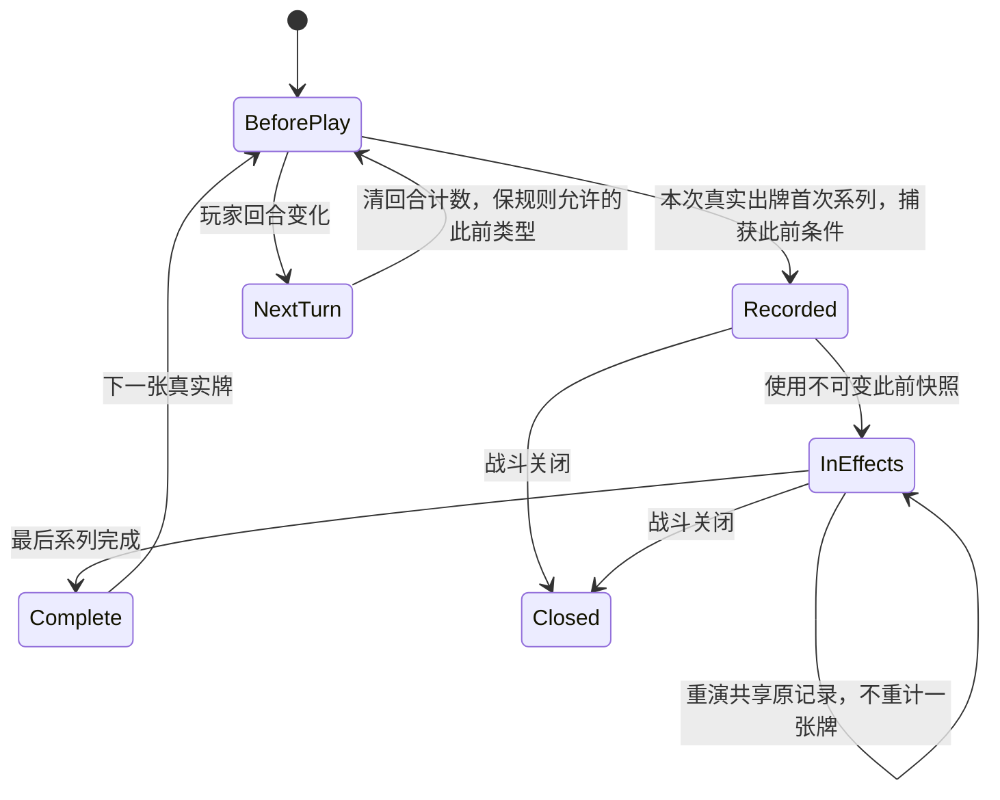

**HISTORY-01** 出牌前雷伤次数、上一张真实牌类型、同目标此前次数与咬痕此前状态不能被本牌新效果自我满足（L10/P03/P04）。**HISTORY-02** 嵌套出牌更新后来的实际历史，但不能改写外层已经捕获的快照；同值不同敌人引用不合并。**HISTORY-03** 重演传入的不同新参数不能覆盖已记录的原身份与目标；已支付后故障不从历史倒扣成“从未出牌”。**HISTORY-04** R14查询当前牌费用时排除当前牌自己的授予，下一实际牌才取得应有连锁优惠。

入口：[AttackHistory](../src/Volibear/Core/AttackHistory.cs)、[TargetCosts](../src/Volibear/Core/TargetCosts.cs)。

## 8. 强制选择与恢复原动作（CHOICE）

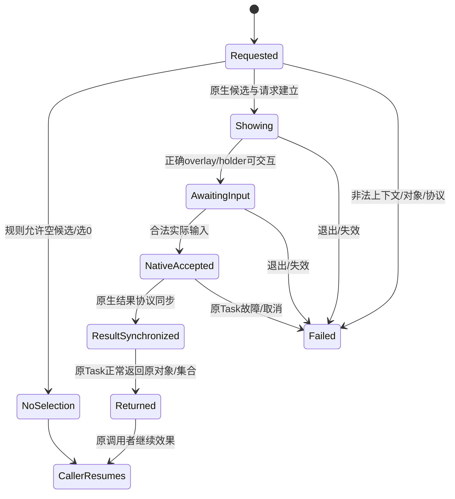

- **CHOICE-01** 候选对象、owner、战斗、overlay、holder与请求一致；不得另建同名卡冒充。
- **CHOICE-02** 明确该入口的结果协议：Knowledge 的 `FromIndex` 不可当作牌堆选择的 `AsCombatCards`。
- **CHOICE-03** 不直接完成 TCS、调用 OnChosen 或发送 Sync 冒充 UI；正常返回后才由原调用者继续。
- **CHOICE-04** pressed/released事件序号严格整数且全局唯一；只规定真实必需偏序，不能假定异步同步事件总在release之后。
- **CHOICE-05** 远端同步buffer为空不等于本地没有待选界面；完成还须核原Task/界面关闭/原动作继续。

Knowledge 首选 index0 只是一个明确分支，不代表其它候选或整只敌人全部覆盖。当前受限 UI transport 候选仍未形成完整可发布修复。

## 9. 召唤与重置（SUMMON）

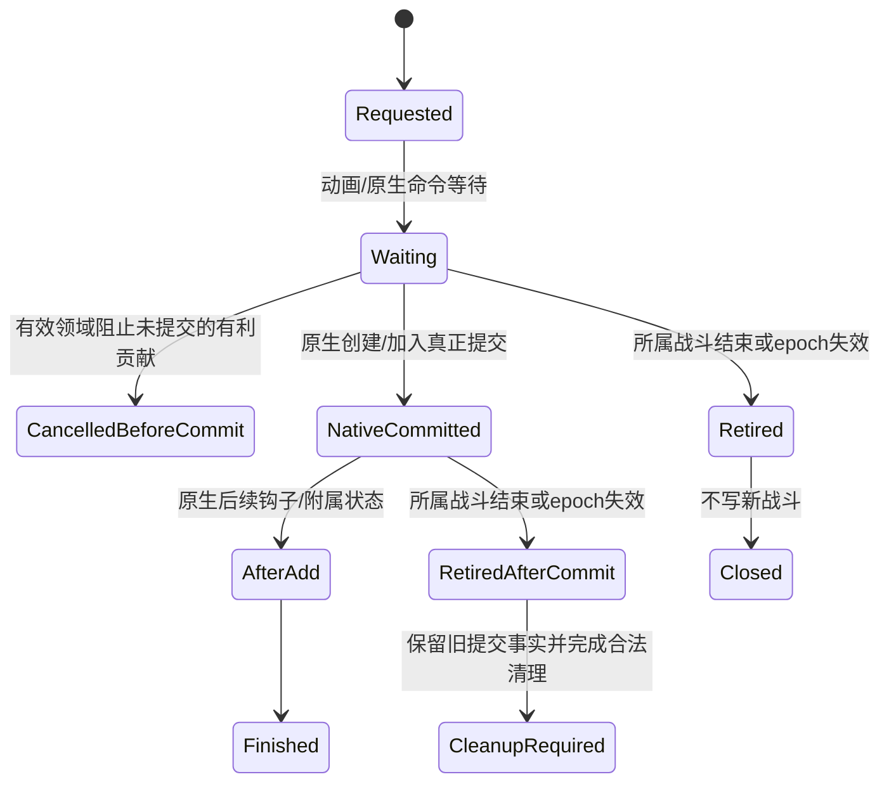

- **SUMMON-01** 原生加入前取消：无新增实体、无附属计数/Power半提交（D10/D17）。
- **SUMMON-02** 加入已提交：不能伪造回滚，也不能为“修复”再生成一只；后续独立有利贡献分别判定。
- **SUMMON-03** reset后原await恢复：不得把旧owner、旧combat、旧Task接到新战斗；未知恢复不得重建有效授权。
- **SUMMON-04** 新怪本轮是否可行动按原生资格，不统一强设不行动（E13）。

**明确缺口：已提交 Add 后的完整原生 reset/清理路径仍未全部解决；图中 `CleanupRequired` 是待实现/验证责任，不是现有 PASS。**

入口：[DomainSummonEffects](../src/Volibear/Core/DomainSummonEffects.cs)。

### 9.1 创建边界的归属与世代（不是完整reset实现）

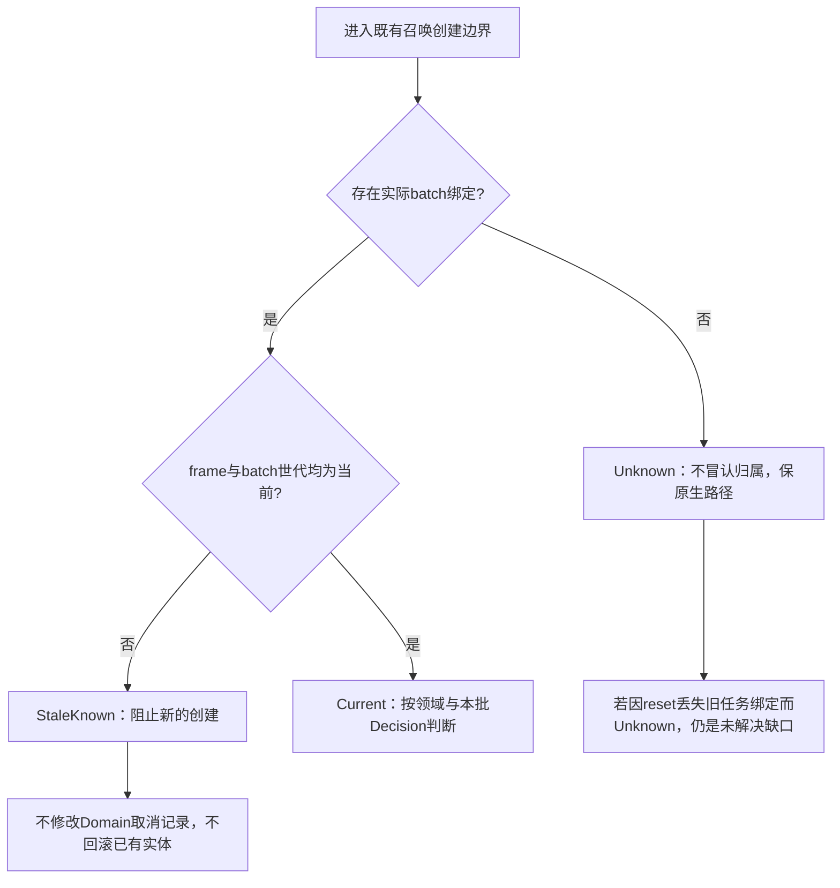

这三个状态不能合并成“没有可用当前记录，所以放行”。**已知拥有但过期**的frame/batch不能获得创建许可；但也不能把所有未知调用都标为领域取消。

该边界修复不包含：reset清空任务映射后的旧任务重新进入、Ovicopter/Fabricator到达guard之前的原生解引用、已Add实体的后续原生初始化/清理、旧Forward新建子调用。这些路径仍需独立状态转换与实现，不能由此图或分类单测宣告安全。

### 9.2 已确权召唤任务的注册与退休（A档接入契约）

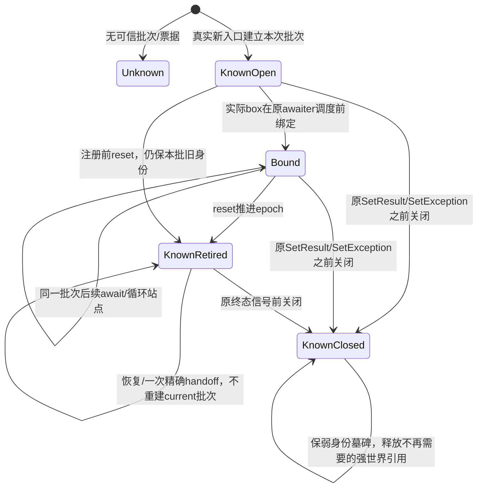

- 原awaiter只调度一次；注册可同步恢复，因此不能等外层MoveNext返回时才首次绑定。ret阶段只可核对身份，不能补写此前缺失的授权历史。
- 新调用与旧任务恢复分开；相同同步CompletedTask不构成相同出生身份。未知调用不得沿用祖先批次，已确权的closed/retired任务也不得降级未知后再次授权。
- 弱power ending索引不等于实际Task身份：新的AfterDeath若仅匹配一个已关闭且未消费取消的旧死亡记录，不得借它把新调用标为旧任务后吞掉原生副作用或异常，须保持Unknown/native；旧记录已消费的取消继续保legacy sticky语义，ending veto查询不得因此复活。完整callback因果授权仍属后续死亡链接入。
- Forward携带精确source/kind的一次票据。旧epoch票据只能继续表示旧批次，不可经当前owner看起来仍活着而重生；不匹配或重复claim不能借祖先。
- 已知退休的SpawnBot须在CombatState读取前、Ovicopter须在slot读取前拒绝新的创建；未知不能因此被错误跳过。原GetResult异常、已Add子单位的Minion/StartStunned等原生后续与cleanup不能被概括性“旧任务就跳尾”吞掉。
- A档只覆盖已经进入并确权的源方法。尚未进入源方法的Outer第一次wait及完整Kill→Hook→callback属于另外原子接线范围；postAdd完整reset安全仍独立待解。这里是实施契约，是否达到以正式生产相关测试和原生验收分层确认。

## 10. 受伤、死亡、否决、复活与阶段（DEATH）

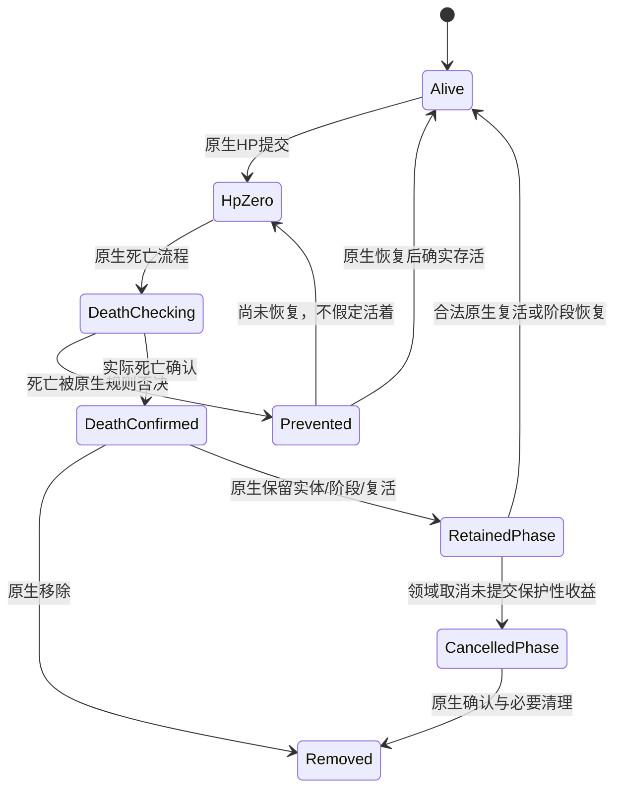

**DEATH-01** HP=0、DamageResult带killed、Died事件、移除、胜利不是同一个事实。**DEATH-02** 最后一敌死亡可能因原生 ending 门没有 DamageReceived history；不能把缺失 history 自动当无伤害。**DEATH-03** 原生否决可能恢复 HP；不能把否决当死亡完成（D14/E11/E12）。

Steam 另有原生阶段序列：`PRESSURIZE建立来源 → 初次死亡/保护阶段 → ABOUT_TO_BLOW移除Power → EXPLODE待执行 → 原生爆发/后续死亡动作`。来源Power被移除不等于已经不存在待处理阶段。单敌HP0时原生可能已进入ending，新的领域请求未必能挂载；不能调用 AfterApplied 强行补成成功。

入口：[DomainRevivalEffects](../src/Volibear/Core/DomainRevivalEffects.cs)、[SteamEruptionDecision](../src/Volibear/Core/SteamEruptionDecision.cs)。

## 11. 偷牌、归还与部分提交（THEFT）

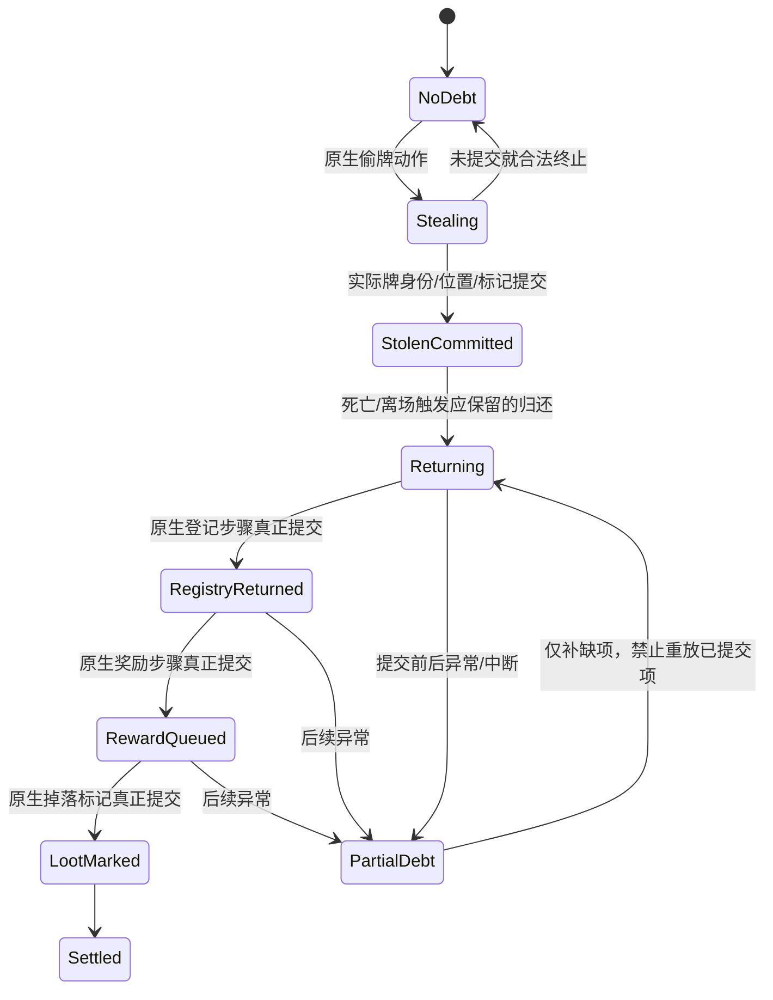

- **THEFT-01** 阻止新的敌方有利偷牌，不阻止已偷牌归还与必要清理（D16）。
- **THEFT-02** 原牌实体、主牌归属与牌区事实分别核对；奖励已排队不等于已经回到牌组。
- **THEFT-03** 每个操作以实际 mutation 提交为界；commit后抛错仍保留该commit，未提交不能伪造receipt。
- **THEFT-04** 后续再进入死亡/领域挂载不能重复返还；未知/伪装patch不能凭owner名获得提交信用。

当前 Hopper 候选的 archive/reset/持久归还与强引用生命周期仍有缺口；这张图不能证明它已整合进正式候选。

## 12. 保存、恢复与表现（SAVE / PRESENTATION）

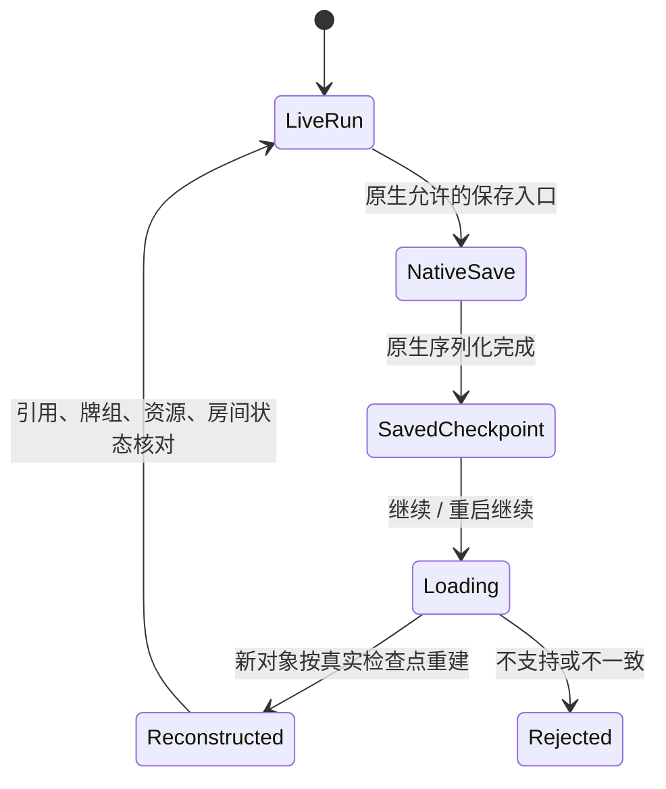

**SAVE-01** 按原生检查点语义恢复，不能把“房间入口重建”宣称为任意中战斗快照恢复。**SAVE-02** 保存前后的完整结构/值和实体关联检查，只有明确的reload字段允许变化。**SAVE-03** 不把临时兽形覆盖写坏永久主牌；旧战斗Task/窗口不能因读取存档复活（S07/F04）。

表现是另一个状态机：`Idle → Playing/Looping → Finished 或 Interrupted → 临时节点/声音清理`。表现不能决定支付、伤害或是否完成动作；快速模式可以改变时长，不能跳过应有结算、停止信号或清理（V02–V08）。

## 13. 必测交叉序列

| 序列 | 必须守住的不变量 | 规则 |
|---|---|---|
| 支付→首普攻→附雷→响应增加雷势→重演 | 支付一次；附雷一次；本批快照不变；后续批读新雷势 | D03/L06/P06 |
| 领域1→敌方→完整起手脏牌净化→扣轮→R28 | 净化仍受保护，扣轮后再处理起手兽化；不能提前过期 | D05/D07/F07 |
| 批量兽化→首转换抽牌→新牌入手→继续原批 | 新牌不加入本批；牌身份/费用/每实例资格不串 | F02/F05/F07 |
| 迎战预占→多段→反击致死→正常敌方阶段 | 不重入/不重复动作；吸收按段；死亡后无幽灵后效 | E03/E05/E11/E14 |
| 召唤等待→领域进入→reset→旧await恢复 | 不生成新战斗实体；不重放已经提交的旧操作 | D10/D17/E16 |
| 偷牌完成→归还第一步commit→抛错→再次死亡回调 | 只补未提交操作；同一牌不丢失也不复制 | D16/E16 |
| 强制选牌→输入→sync→原返回→Power→敌人动作完成 | 原对象/协议/调用链闭合；选项显示不是效果完成 | E08/E09/S02 |
| 雷伤Pending→额外玩家回合→旧Complete→新Batch | 旧票据无效；本回合计数正确；领域正常轮时钟不被误扣 | L05/D05 |

上述跨状态机序列必须测试中间态，不能只检查最终 HP 或最终牌数，因为“先错再恢复”可能掩盖问题。

## 14. 单元测试落地与真机边界

1. **纯生产内核序列测试**：直接编译/调用现有 C# 内核，覆盖状态转换、边界、重复、关闭、跨回合/跨战斗；不另写一套模拟器然后只验证模拟器自己。
2. **真实程序集适配测试**：检验实际参数、调用次数、原 Task/异常、patch组合与字段签名；人工CLR形状必须明确标注，不能称原生战斗已测。
3. **具体牌效与敌人适配测试**：按[逐卡特殊分支](TEST_SPEC.md)和 E/D/L/F/P 逐行补独立预期。代码有对应方法不等于该转换已测。
4. **集中真机验收**：同一稳定候选验证原生支付/选择/AI推进/死亡/存档/视觉声音与安装流程；单元测试无法证明的部分留在这里，不在开发中频繁启动应用。

## 15. 第一批直接生产内核测试映射

[正式测试入口](../tests/test_gameplay_state_sequences.py)调用[命名序列](../tests/gameplay_state_sequences/Program.cs)，[工程](../tests/gameplay_state_sequences/GameplayStateSequences.csproj)直接编译当前生产内核文件；不复制内核，不引用旧stage或预编译Mod。以下描述测试范围，不记载运行结果。

| 命名序列 | 对应状态/规则 | 实际调用 | 明确不证明 |
|---|---|---|---|
| card-domain-replay-close | CARD-04/05、LIGHTNING-04；D01–D03/L12 | PlayGate + LightningCounter：晚进入、重入、完成、重复、关闭、新实例 | 实际付款/重演调度/伤害/不同owner适配 |
| domain-two-clocks | DOMAIN-01–04、LIGHTNING-03；D05/D06/L05 | DrawClock + Duration + LightningCounter：额外玩家回合、正常边界、重复/倒序通知、永久 | 原生抽牌与R28调用顺序；测试中的轮数递减是显式编排 |
| lightning-pending-epoch-close | LIGHTNING-04；L03/L05/L12 | LightningCounter：多pending、局部Abort、完成、epoch ABA、重复Close | 原生伤害与listener故障；票据所属owner由适配器保证 |
| beast-reference-clone-lifetime | FORM-01/04；F02/P02 | BeastCostLedger：值相等不同引用、多代clone、过期、后加Set、形态基础费用 | 原牌实体覆盖、实际支付与消耗 |
| steam-death-evidence | DEATH-01/03、EFFECT-02；D14/D17 | SteamEruptionDecision：观察领域、否决、真实确认、取消锁存、伤害贡献门 | 原生实际死亡、领域实际挂载 |
| steam-commit-and-identity | EFFECT-02、DEATH-01；D14/D17 | SteamEruptionDecision：引用身份、epoch、写后事实不回滚/不重复 | 原生HP确实发生；这里只测试写后账本 |
| steam-terminal-guards | DEATH、RUN-03；D14/E16 | SteamEruptionDecision：ancestor/firstDeath/inflight/tail组合与一次终结 | 实际调度是否传入正确guard |
| steam-veto-and-retirement | DEATH-03、RUN-03；D14/E16 | SteamEruptionDecision：veto保留、受限再开放、外部死亡、attached拒退役 | 原生veto/解绑/清理与存档 |

### 15.1 已有测试的证据分层

- [领域记账](../tests/domain_bookkeeping/Program.cs)、[雷伤记账](../tests/lightning_bookkeeping/Program.cs)、[兽化费用](../tests/beast_bookkeeping/Program.cs)、[历史与目标费用](../tests/history_bookkeeping/Program.cs)：实际内核行为，不是正常输入或整牌效果验收。
- [召唤](../tests/domain_summon_effects/Program.cs)、[被动贡献](../tests/domain_passive_effects/Program.cs)、[复活](../tests/domain_revival/Program.cs)：部分纯决策加真实程序集形状检查；二者不能互相冒充，更不能代替原生战斗。
- [迎战生命周期检查](../tests/test_engage_lifecycle.py)仍是源码字符串契约，仅证明接线形状；新增[正式机会内核](../src/Volibear/Core/EngageOpportunityLedger.cs)已被[实际迎战](../src/Volibear/Core/EngageCmd.cs)调用，[机会序列](../tests/engage_opportunities/Program.cs)直接测试它，不另建并行模拟器。实际原生动作/吸收/responders仍需N。

### 15.2 原生适配与尚缺行为测试的映射

层级：**S**＝源码实现已定位；**U**＝有直接生产内核行为测试（不表示本次执行结果）；**C**＝静态源码/IL契约；**N**＝仍须原生验收。S/C不等于U，U不等于N。无对应行为单测时明确留空缺，不把文件存在计为覆盖。

| 状态转换 | 真实生产入口 | 现有具体测试与缺口 |
|---|---|---|
| CARD-01/02 前置拒绝/支付 | [TargetCosts](../src/Volibear/Core/TargetCosts.cs) `CanPlayResolved/SpendResolved/ResolvedTargetCallsites` | C：[历史契约](../tests/test_history_contracts.py) `test_native_preflight_and_payment_not_current_target_or_refund`；实际正常输入/支付N，尚无独立支付内核U |
| CARD-03、HISTORY 真实牌/重演 | [AttackHistory](../src/Volibear/Core/AttackHistory.cs) `BeforeNativeHooks/AfterNativeHooks`，`PlayHistoryLedger.Record/Complete` | U：[历史内核](../tests/history_bookkeeping/Program.cs)顶层Record/Complete序列；原生多系列与付款N |
| DRAW-01/02 净化/补抽 | [CardResolutionHooks](../src/Volibear/Core/CardResolutionHooks.cs) `AddDrawnCard/PurifyThenDispatch`，[DomainPower](../src/Volibear/Core/DomainPower.cs) `AfterCardDrawnEarly` | S/N；缺完整净化事务行为U，DrawClock不替代此项 |
| FORM-01/02/04 转换/消费 | [BeastForms](../src/Volibear/Core/BeastForms.cs) `Convert/DispatchPlay/ResultPile` | S/N；费用账本U不覆盖实体、牌区或转换listener异常 |
| FORM-03、CHOICE 兽化选择 | [BeastSelection](../src/Volibear/Content/Cards/BeastEffects.cs) `Transform` | S/N；固定集合已实现，`Transform`本身没有Distinct/重复拒绝，F06依赖原生selector，仍需独立行为断言 |
| FORM-05、DEPLOY 独立首次 | [BeastPowers](../src/Volibear/Core/BeastPowers.cs) `BearSpiritPower.AfterConversion/BeforeCardPlayed`、`WildernessPower.BeforeCardPlayed` | S/N；缺抽取后的实际首次资格U，不以只测入场效果代替 |
| CHOICE 检索/预见/消耗材料 | [ControlledEffects](../src/Volibear/Content/Cards/ControlledEffects.cs) `Retrieve/Scry/ExhaustAnother` | C：[控制牌契约](../tests/test_controlled_cards.py) `test_native_selections_capacity_identity_and_scry_order`；退出、候选移动、满手和实际结果N |
| CHOICE 敌人强制选牌 | 原生Knowledge `ChooseCurse → FromChooseACardScreen → OnChosen` | 原生源码已定位；受限transport仅stage的C/门禁测试，完整原生输入/下游效果N，不是正式修复 |
| SUMMON 多边界 | [DomainSummonEffects](../src/Volibear/Core/DomainSummonEffects.cs) `DeathDecision.AtBoundary/CancelAtGate/Reset` | U/C：[召唤测试](../tests/domain_summon_effects/Program.cs) `Decisions/Shapes/Combined`；post-Add reset仍缺完整实现/组合N |
| DEATH 复活与被动提交 | [DomainRevivalEffects](../src/Volibear/Core/DomainRevivalEffects.cs) `RevivalDecision`；[DomainPassiveEffects](../src/Volibear/Core/DomainPassiveEffects.cs) `Decision.Decide` | U/C：[复活测试](../tests/domain_revival/Program.cs)、[被动测试](../tests/domain_passive_effects/Program.cs)顶层决策序列；所有敌人自然分支仍N |

### 15.3 仍须补足的状态覆盖

1. 迎战机会、跨轮、reset和多实例已有直接生产内核序列，但仍需适配器/原生生命周期组合验证。§3.1已按原生切侧与快照时序解释新敌机会，不能把未查 `SpawnedThisTurn` 当缺陷并一刀切封禁；四类实际场景仍待原生验收。
2. 召唤多边界与reset后续、复活/被动提交对照、偷牌归还部分提交与生命周期；未整合stage不计正式实现。
3. 原生付款、完整兽化覆盖、净化补抽、各独立部署首次响应、选择退出等缺少纯内核的部分，先抽取实际生产责任或用真实程序集离线夹具；不能一概推给真机。
4. 每张牌基础/升级及特殊分支、逐敌自然状态转换仍按原规格建立测试。第一批8条序列并不覆盖全部89卡或全部敌人。

### 15.4 测试自身的行为失效检测（G7）

[正式测试入口](../tests/test_gameplay_state_sequences.py)的 `test_behavioral_mutations_are_rejected` 在独立临时目录中故意修改一份生产内核，再编译同一组断言：

| 隔离变异 | 必须被哪条断言检出 |
|---|---|
| 去掉同出牌已附雷资格检查 | card-domain-replay-close：pending期间重入不能再次附雷 |
| 正常抽牌时钟将同轮也视为下一轮 | domain-two-clocks：额外玩家回合不能扣领域轮数 |
| 雷伤完成不消费pending票据 | lightning-pending-epoch-close：已Abort的票据不能完成 |
| 兽化费用继承按值相等合并对象 | beast-reference-clone-lifetime：只有原引用属于继承集合 |
| Steam永远压制匹配来源正伤害 | steam-death-evidence：确认死亡且无领域时仍允许原生收益 |

变异必须先**编译成功**，然后因指定行为断言失败；编译报错、运行器失效或缺少成功标记本身不算检出。临时变异不修改生产源码，也不进入发布构建。此集合只是新增序列的失效检测，不代替原规格全部G7变异。

### 15.5 迎战机会内核的直接序列

[机会内核](../src/Volibear/Core/EngageOpportunityLedger.cs)是生产唯一机会账本，代替原两个字典；实际[迎战适配器](../src/Volibear/Core/EngageCmd.cs)调用其预占、自然动作观察、消费查询和generation检查。

| [命名序列](../tests/engage_opportunities/Program.cs) | 规则与中间态 |
|---|---|
| reserve-reentry-partial-failure | E05/E16：await前预占、同敌重入拒绝、部分失败不返还机会 |
| natural-versus-early-skip | E14/E20：自然动作也消费迎战资格，但只有提前消费可授权后续正常阶段跳过 |
| round-and-separate-enemies | E06/E10：同战Ensure不清账、下一轮重新合法、不同敌人不串额度 |
| reference-equality-collisions | E07/E15：值相等但引用不同的敌人/战斗不能合并 |
| combat-and-enemy-membership-guards | E07/E16：未建立权限、外战、脱离实体、迟到输入不得暗中重建权限 |
| reset-and-combat-aba | E16/D18：reset立即撤权、同对象重开不继承旧generation、A→B→A不复活旧窗口 |
| suspended-interleaving | E05/E16：实际受控Task暂停时重入、换战后恢复；只测试内核授权，不执行原生move |
| diagnostic-entry-counts | 清理诊断兼容：early与natural分别投影；同敌可各计1，跨轮保条目、换战/reset归零 |

[正式Python入口](../tests/test_engage_opportunities.py)要求完整命名集合及各序列结果；编译失败不回退旧DLL，缺SDK明确NOT_RUN。诊断使用只读投影并保留原JSON键，不恢复第二套可变账本。

范围限制：这里保证的是**迎战窗口权限失效**，不表示已经取消原生无取消令牌的等待，也不证明旧native move本体不再执行任何操作。完整RUN-03仍须逐个适配器和原生边界验证。`EnsureCombat`只能由已验证实际当前战斗的适配器入口调用。

### 15.6 召唤/复活决策与实际适配门

[召唤决策](../src/Volibear/Core/DomainSummonDecision.cs)和[复活决策](../src/Volibear/Core/RevivalDecision.cs)从原生产文件原样抽出，原类型名/API保持；生产适配器仍直接调用这些类型。召唤创建门额外区分Unknown/Current/StaleKnown，修复已知过期授权被当成未知而放行的窄路径。

| [直接生产序列](../tests/domain_lifecycle_states/Program.cs) | 实际范围 |
|---|---|
| summon-partial-boundary-close | 首边界允许、领域进入后取消剩余、退出/Close不补发；不创建任何原生child |
| summon-prevented-close-independent | Close在首次eligible前、prevented不消费或撤销取消、独立batch不串状态 |
| summon-known-stale-versus-unknown | 无绑定不冒认权限，frame/batch任一世代失效均为StaleKnown，独立当前批不被污染 |
| revival-pending-confirmed-cancelled | 待确认、原生否决、领域已见、真实确认与取消锁存；未确认/已取消禁止commit |
| revival-commit-versus-domain | 允许侧先commit后领域不回滚，领域先到则禁止commit；不同实例隔离 |
| revival-reference-authority | 原source/owner/target引用、世代和取消条件；值相等的其它对象不能借权限 |
| revival-unstarted-callback | 只跳本实例尚未开始且已禁止的回调，不跳已开始/无归属/允许的调用 |

[正式Python入口](../tests/test_domain_lifecycle_states.py)编译实际纯源文件；不是复制模型。四个旧显式源码测试项目同步链接新文件；旧自包含 `SummonSource/RevivalSource` override默认不再强塞新决策源，外置决策可显式指定路径。

[实际适配门测试](../tests/domain_steam_v1/SummonBoundaryAdapterTests.cs)在真实程序集引用下构造生产私有Frame/Binding/Batch，调用实际Reset与实际CancelAtGate：未知仍放原生、已知过期阻新创建、fixture Task引用不变、不冒设Domain取消。这里只使用未初始化的原生类型对象作身份，不执行世界状态、Add、HP、原生await或清理。因此它补上了“分类内核是否真正接入adapter”的证明，**仍不证明完整战斗reset安全**。

### 15.7 雷伤批次完成后的部署响应

[真实响应循环](../src/Volibear/Core/LightningResponseDispatch.cs)由[LightningBatches.Notify](../src/Volibear/Core/LightningBatches.cs)调用。它只管一次快照、逐项检查和串行await；真实世界的owner/combat/round/playerTurn权限仍由Notify原有条件判定，不由通用循环猜测。

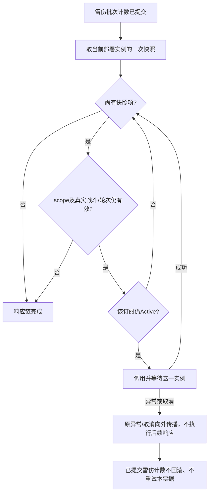

[直接生产序列](../tests/lightning_responses/Program.cs)覆盖串行受控Task、回调中新部署只入下一批、失活/移除跳过、关闭后恢复停尾、fault/cancel后真实Counter已提交事实、相同delegate的不同实例、嵌套独立快照、空快照不读取世界。项目直接编译正式循环与Counter；fixture只提供输入，不复刻调度器。

[实际订阅适配测试](../tests/domain_steam_v1/LightningResponseAdapterTests.cs)补充真实Subscription.Invoke/Dispose、OwnerScope和ResetCombatState的连接：Dispose幂等且不误停其它实例；实际reset关闭两owner并移除订阅；在途回调原Task不被假完成，原Task结束后不再开始后续回调。原生类型对象只作身份，不执行CanUse、HP、真实round/turn或场景。

**reset不等于取消已进入回调的内部代码。**该循环只能阻止后续响应；已进入的回调若跨await后还要写世界，仍须由其自身生命周期规则验证。此次是既有行为的可测试抽取，不是新增雷伤规则或完整native reset修复。

### 15.8 Summon A档生产注册、关闭与票据

[实际注册与寿命实现](../src/Volibear/Core/SummonRegistration.cs)已由[召唤适配器](../src/Volibear/Core/DomainSummonEffects.cs)接入六个原源方法的MoveNext；不是对冻结stage副本单独自测。原await注册方法的完整多重集合先核对再改写，不能只发现一个await就宣称全部已接入。

| 正式入口 | 证明层级与限制 |
|---|---|
| [真实CLR矩阵](../tests/summon_registration/Program.cs) | 调用生产bridge而非手动Bind：实际box在原调度前绑定、inline-beforeLeave、重复同site、nested/suppressed-flow、unknown原路径、epoch变化、TCS成功/异常/取消、root和两个child共享批次、错source/kind、完成Task仍存活时payload/source可GC |
| [原生IL及适配检查](../tests/domain_summon_effects/Program.cs) | 锁版六源的全部注册锚点、缺/增/改awaiter拒绝、原GetAwaiter/GetResult顺序、helpers字段到SpawnBot路径、早guard位置、Revival双安装顺序；实际Forward→Enter身份fixtures，不执行原生怪物世界 |
| [死亡决策序列](../tests/domain_lifecycle_states/Program.cs) | 新callback不能借closed未消费的ending索引成为旧任务；已消费取消保持sticky；与真实旧Task墓碑分开 |
| [实际私有门与探针](../tests/domain_steam_v1/SummonBoundaryAdapterTests.cs) | unknown/retired/closed实际门；Close脱强payload仍拒旧权限；D17退休行仅metadata，不读世界或伪装Domain取消 |
| [D17证据反例](../tests/test_domain_summon_d17_evidence.py) | 原live验收oracle不放宽，退休metadata不能顶替真实领域取消证据；这是oracle测试，不是游戏运行 |

尚未覆盖：原awaiter**注册函数自身抛错**的fatal parity（不能由GetResult fault代替）、Outer首次wait到源入口、完整Kill→Hook→callback归属、postAdd完整reset安全、全局foreign patch原子性。保留既有entry builder.Task getter影响；closed/unknown返回时不再读取被CLR清空的builder，但不能宣称全路径零getter或完整fullReset。

补充原生调度事实：锁定版本的 `TakeTurn` 主要负责 `SpawnedThisTurn` 判断和 `PerformMove`，外层敌方阶段仍负责暂停/胜负及回合结束；不能仅因补丁跳过TakeTurn就断言外层生命周期全丢。`PerformMove` 在首次等待之后才选择实际NextMove，开始时看到的意图不能作为后续实际move的唯一证据。
